  

 

### 👨‍💻 Sobre Mim

- 🎓 Graduando em **Ciência da Computação** na **Universidade Federal do Ceará (UFC — Campus Russas)**.
- ☕ Foco principal em **Back-end com Java 21 & Spring Boot 3**, projetando APIs RESTful com **controle de concorrência (`@Version`)**, cache distribuído com **Redis**, migrations com **Flyway**, **PostgreSQL**, **Docker** e testes automatizados (**JUnit 5**).
- 🤖 Projetos complementares em **Python / FastAPI** aplicados a **Machine Learning e Pesquisa Operacional**, além de sistemas embarcados e **IoT** com **ESP32** e **C/C++**.

---

### 🚀 Projetos em Destaque

  <table>
    <tr>
      <td width="50%" align="center">
        
      </td>
      <td width="50%" align="center">
        
      </td>
    </tr>
    <tr>
      <td width="50%" align="center">
        
      </td>
      <td width="50%" align="center">
        
      </td>
    </tr>
  </table>

| Projeto | Problema de Engenharia & Stack |
| :--- | :--- |
| [**`nexushub-api`**](https://github.com/AlissonPazLopes/nexushub-api) | API SaaS B2B com credenciamento em níveis, resgate de benefícios concorrente (`@Version`), lotes CSV com checksum `SHA-256` e PostgreSQL · `Java 21` `Spring Boot 3` `Flyway` `Docker` `JUnit 5` |
| [**`edgepulse-api`**](https://github.com/AlissonPazLopes/edgepulse-api) | Plataforma de telemetria IoT/ESP32 com watchdog de heartbeat, atualização OTA com rollback e métricas de confiabilidade (`MTBF`/`MTTR`) · `Java 21` `Spring Boot 3` `PostgreSQL` `Redis` |
| [**`viabus-api`**](https://github.com/AlissonPazLopes/viabus-api) | Sistema de reservas intermunicipais e cotas sociais ID Jovem com Optimistic Locking contra *overbooking* e expiração automática · `Java 21` `Spring Boot 3` `PostgreSQL` `Redis` |
| [**`smartroute-optiml-api`**](https://github.com/AlissonPazLopes/smartroute-optiml-api) | Previsão de demanda com Scikit-Learn e roteamento de coleta seletiva via Programação Linear (PuLP) e meta-heurística VNS · `Python` `FastAPI` `Scikit-Learn` `Pytest` |

---

### 🛠️ Stack Tecnológica

  <b>Back-end, Dados &amp; Infraestrutura</b>  
  
    
  <b>IA, Otimização &amp; Embarcados</b>  
  
    
  <b>Base Web &amp; Ferramentas</b>  
  

---

### 📊 Métricas &amp; Consistência

  
  &nbsp;
  

 

  

 

<!-- Dica futura: na GitHub Action do Snake (.github/workflows), também é possível customizar color_snake e color_dots para tons de roxo (#a855f7 / #c084fc). -->

  

---

### 📫 Contato

  
  &nbsp;&nbsp;
  
  &nbsp;&nbsp;
  

 

  

